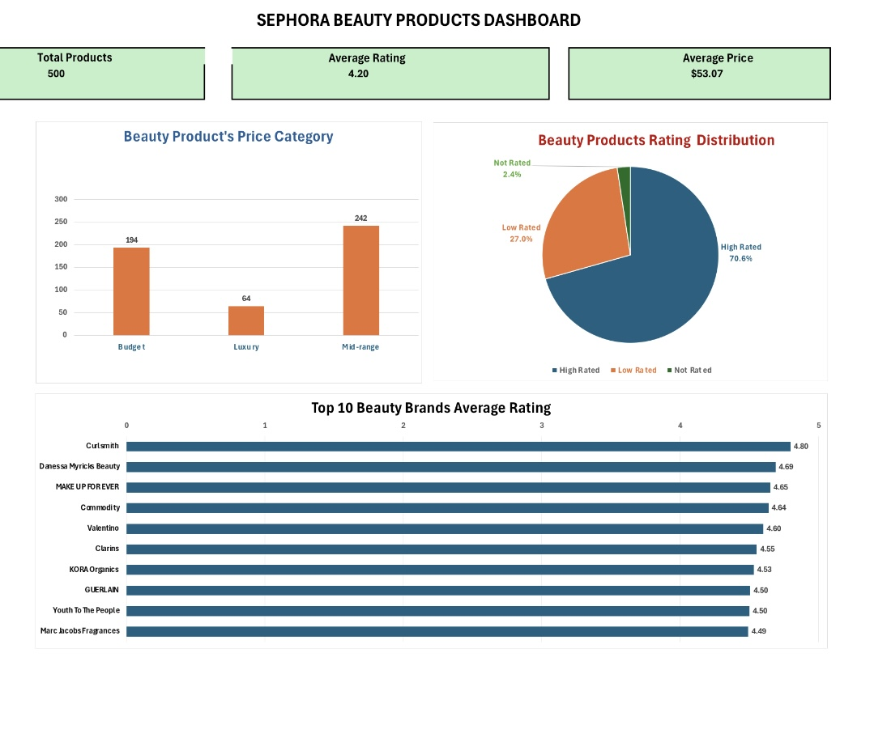

# Sephora Beauty Products Data Analysis | Excel Project

## Project Overview

This personal project analyses a sample of 500 Sephora beauty products using Microsoft Excel. The aim is to explore product pricing, customer ratings and brand performance through data cleaning, formulas, Pivot Tables and dashboard visualisations.

## Project Objectives

* Assess data quality and identify missing or invalid values.
* Analyse beauty product prices across different categories.
* Explore customer rating distributions.
* Compare the average ratings of beauty brands.
* Present findings through an Excel dashboard.

## Tools and Techniques

* Microsoft Excel: Data analysis and visualisation
* Data Cleaning: Missing values, duplicate IDs and price validation
* Excel Formulas: VLOOKUP, IF, COUNTIF, COUNTBLANK, AVERAGE and other functions
* Pivot Tables: Summarising brand performance
* Charts: Column charts, pie chart and horizontal bar chart
* Product Lookup: Retrieving product information using VLOOKUP

## Key Findings

Metric	Result
Products Analysed	500
Average Product Price	$53.07
Average Product Rating	4.20
Budget Products	194
Mid-range Products	242
Luxury Products	64
High-Rated Products	353 (70.6%)
Highest Average Rating in Top 10 Chart	Curlsmith (4.80)

Insights

* Mid-range products represent the largest price category, accounting for 48.4% of the analysed products.
* 70.6% of products fall into the high-rated category.
* Curlsmith has the highest average rating in the displayed top 10 brand comparison, based on four products in the sample.

## Data Cleaning

The workbook includes checks for missing ratings, missing reviews, duplicate product IDs, missing prices and invalid prices.

## Dashboard

The dashboard presents three key performance indicators and visual comparisons of product price categories, rating distributions and brand performance.

## Workbook Structure

* Dashboard: Visual summary of analysis
* Beauty_500_Raw: Selected product dataset
* Data_quality: Data quality checks and summary statistics
* Product_lookup: Product information retrieval
* Price_category_Analysis: Pricing category breakdown
* Rating_distributionR: Rating distribution summary
* Top_10_Brands: Brand rating comparison

## Excel Workbook

[View or Download the Excel Project](Sephora_beauty_project_analysis.xlsx)

## Project Type

Personal Data Analysis Portfolio Project | October 2026
## Dashboard Preview

## Key Findings

* Total Products Analysed: 500 Sephora beauty products.
* Average Product Rating: 4.20, indicating generally positive customer ratings within the dataset.
* Average Product Price: $53.07.
* Price Category Distribution: Mid-range products represent the largest category (242 products, 48.4%), followed by budget products (194, 38.8%) and luxury products (64, 12.8%).
* Customer Rating Distribution: 70.6% of products are classified as highly rated, while 27.0% are low rated and 2.4% are not rated.
* Top-Rated Brand: Curlsmith has the highest average rating (4.80) among the top 10 brands shown in the dashboard.

## Conclusion

The analysis shows that mid-range products make up the largest proportion of the dataset, while most products fall into the high-rating category. These findings demonstrate how Excel can be used to clean, analyse and visualise product data to identify pricing patterns and customer rating trends.
